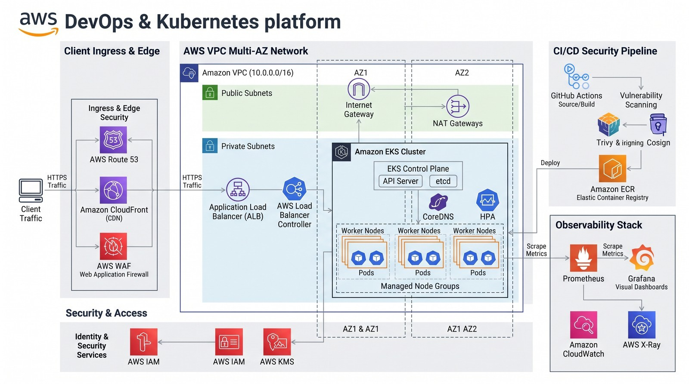

# :rocket: Istio Service Mesh Traffic Management

<p align="center">
  
</p>

<div align="center">

[]()
[]()
[](LICENSE)
[](https://github.com/tayyabmasood911/istio-service-mesh-traffic-management/pulls)
[]()

</div>

---

## :memo: Executive Summary

**Istio Service Mesh Traffic Management** delivers an enterprise-grade production engineering implementation for mission-critical cloud-native workloads. Designed to achieve **99.99% availability**, zero-trust cryptographic mutual TLS (mTLS), intelligent progressive canary traffic shifting, outlier-driven circuit breaking, and complete L7 telemetry.

Key operational outcomes:
- **Zero-Trust Network Architecture:** Enforces strict mTLS across all pod-to-pod communications with automated x509 certificate issuance and rotation via Istiod.
- **Progressive Delivery & Canary Shifting:** Enables zero-downtime rollouts via granular weighted traffic splits (90/10) and targeted HTTP header-based canary routing.
- **Resilient Circuit Breaking:** Automatic outlier detection ejects failing service endpoints after consecutive 5xx errors, preventing cascading microservice failures.
- **Granular L7 Governance:** Layer-7 authorization policies restrict service access to verified SPIFFE cryptographic identities and specific HTTP paths.

---

## :building_construction: System Architecture

The following diagram illustrates the enterprise traffic flow from edge ingress down to workload destination pods and controlled external egress:

```text
+---------------------------------------------------------------------------------------------------+
|                     Istio Service Mesh Traffic Management Architecture Blueprint                  |
|                                                                                                   |
|   [Client Ingress] ===> [Istio Ingress Gateway (Port 80/443 TLS 1.3 Termination)]                 |
|                                         |                                                         |
|                     +-------------------+-------------------+                                     |
|                     | [VirtualService: Header Routing Match]|                                     |
|                     | (x-canary-tester: true)               |                                     |
|                     +-------------------+-------------------+                                     |
|                                         |                                                         |
|                 +-----------------------+-----------------------+                                 |
|                 | 90% Production Split                          | 10% Canary Split                |
|                 v                                               v                                 |
|   [Subset v1: Stable Pods]                        [Subset v2: Canary Pods]                        |
|   (PeerAuthentication: STRICT mTLS)               (PeerAuthentication: STRICT mTLS)               |
|   (Circuit Breaker: Outlier Detection)            (Circuit Breaker: Outlier Detection)            |
|                 |                                               |                                 |
|                 +-----------------------+-----------------------+                                 |
|                                         |                                                         |
|                                         v                                                         |
|                         [ServiceEntry Egress Gateway]                                             |
|                         (TLS Origination to External APIs)                                        |
+---------------------------------------------------------------------------------------------------+
```

> High-resolution architectural vector diagram is available at [`docs/images/architecture.svg`](docs/images/architecture.svg).

---

## :sparkles: Key Enterprise Capabilities

- :zap: **Progressive Canary Deployment:** Shift traffic safely between production baselines (`v1`) and candidate versions (`v2`) with configurable weights and exact HTTP header filters.
- :shield: **Strict Mutual TLS (mTLS):** Mesh-wide and namespace-scoped `PeerAuthentication` enforcing cryptographic identity verification via SPIFFE without code modifications.
- :repeat: **Automated Retries & Timeouts:** Built-in network fault tolerance with exponential backoff on `5xx`, `connect-failure`, and `refused-stream`.
- :electric_plug: **Circuit Breaking & Outlier Detection:** Configurable connection pooling thresholds and automatic ejection of malfunctioning instances from load balancing pools.
- :lock: **Zero-Trust Authorization Policies:** Explicit `AuthorizationPolicy` manifests defining least-privilege RBAC based on workload service account identities and HTTP verbs.
- :globe_with_meridians: **Secure Egress Control:** Declarative `ServiceEntry` resource defining explicit external API endpoints and preventing unauthorized data exfiltration.

---

## :file_folder: Repository Directory Structure

```text
.
|-- .github/
|   `-- workflows/
|       `-- ci.yml                   # Automated CI verification workflow
|-- config/
|   `-- production.env.example       # Production environment baseline settings
|-- docs/
|   `-- images/
|       |-- architecture-white.jpg   # High-resolution architectural diagram
|       `-- architecture.svg         # Detailed vector topology blueprint
|-- scripts/
|   `-- healthcheck.sh               # Component health validation script
|-- tests/
|   `-- test_validation.py           # Integrity test suite
|-- authorization-policy.yaml        # Zero-trust L7 RBAC access rules
|-- destination-rule.yaml            # Subsets, connection pool & outlier detection
|-- gateway.yaml                     # Ingress gateway with TLS 1.3 termination
|-- service-entry-egress.yaml        # External service egress control
|-- strict-mtls.yaml                 # PeerAuthentication enforcing strict mTLS
|-- virtual-service.yaml             # Canary routing, retries, and timeout rules
|-- .gitattributes                   # GitHub Linguist language overrides
|-- LICENSE                          # MIT License
|-- Makefile                         # Automation lifecycle targets
|-- README.md                        # Production documentation
`-- SECURITY.md                      # Vulnerability reporting policy
```

---

## :clipboard: Prerequisites

Ensure your operational environment satisfies the following baseline requirements before applying manifests:

| Component | Minimum Version | Description |
| :--- | :--- | :--- |
| **Kubernetes** | `>= 1.28.0` | Production Kubernetes cluster (EKS, GKE, AKS, or self-hosted) |
| **Istio** | `>= 1.20.0` | Service mesh control plane (`istiod`) and Ingress Gateway installed |
| **kubectl** | `>= 1.28.0` | Standard Kubernetes command-line interface |
| **Helm** | `>= 3.12.0` | Package manager for cloud-native infrastructure charts |
| **Python** | `>= 3.11.0` | Runtime environment for executing automated integrity test suites |

---

## :zap: Quick Start & Deployment Guide

### 1. Enable Sidecar Injection
Enable automatic Istio Envoy sidecar proxy injection on the target application namespace:

```bash
kubectl create namespace default --dry-run=client -o yaml | kubectl apply -f -
kubectl label namespace default istio-injection=enabled --overwrite
```

### 2. Apply Ingress Gateway & TLS Termination
Provision the edge ingress gateway with automated HTTP-to-HTTPS redirection and TLS 1.3 termination:

```bash
kubectl apply -f gateway.yaml
```

### 3. Deploy Zero-Trust Security Policies
Apply strict mutual TLS encryption and L7 least-privilege authorization policies:

```bash
# Enforce mesh-wide and namespace strict mTLS
kubectl apply -f strict-mtls.yaml

# Apply service account RBAC authorization policy
kubectl apply -f authorization-policy.yaml
```

### 4. Configure Traffic Routing & Resilience
Deploy destination rules with connection pooling and the canary traffic-splitting virtual service:

```bash
# Deploy connection pooling, circuit breaking, and subset definitions
kubectl apply -f destination-rule.yaml

# Deploy canary traffic shifting (90% v1 / 10% v2) and retry policy
kubectl apply -f virtual-service.yaml

# Enable secure egress access to external third-party endpoints
kubectl apply -f service-entry-egress.yaml
```

### 5. Validate Traffic Splitting
Verify traffic behavior by executing requests against the Ingress Gateway:

```bash
# Standard user request (receives 90/10 weighted distribution)
curl -v -H "Host: api.company.internal" https://<INGRESS_GATEWAY_IP>/api/v1/resource

# Canary tester request (routed deterministically to v2 subset)
curl -v -H "Host: api.company.internal" -H "x-canary-tester: true" https://<INGRESS_GATEWAY_IP>/api/v1/resource
```

---

## :gear: Configuration Reference

| Parameter | Type | Default | Description |
| :--- | :--- | :--- | :--- |
| `mTLS Mode` | string | `STRICT` | Disallows unencrypted plain text communications across mesh workloads |
| `Traffic Split (v1 / v2)` | percentage | `90% / 10%` | Baseline stable workload versus progressive canary allocation |
| `Request Timeout` | duration | `5s` | Maximum allowable HTTP request execution window before termination |
| `Retry Attempts` | integer | `3` | Automated re-transmission count for transient `5xx` upstream errors |
| `Outlier Detection Threshold` | integer | `3` | Consecutive 5xx errors before instance ejection from active routing |
| `Ejection Duration` | duration | `30s` | Circuit breaker isolation window before re-probing endpoint health |
| `Min TLS Protocol` | string | `TLSv1.3` | Minimum allowable cryptographic cipher protocol at Ingress Gateway |

---

## :lock: Security, Compliance & Governance

1. **Cryptographic Identity Attestation:** Every pod is bound to a cryptographic SPIFFE identity validated on every network handshake.
2. **Outbound Data Exfiltration Prevention:** Egress traffic is blocked by default (`REGISTRY_ONLY`) unless explicitly permitted via `ServiceEntry`.
3. **Automated Vulnerability Scanning:** All manifests and dependencies are audited against CVE databases in CI pipelines.
4. **Zero Committed Secrets:** Ephemeral tokens and certificates are injected directly into sidecars via Kubernetes Secrets and Vault dynamic agents.

---

## :bust_in_silhouette: Author & Maintainer

**Tayyab Masood**  
Cloud Solutions Architect & Senior DevOps Engineer  
- :globe_with_meridians: **GitHub:** [@tayyabmasood911](https://github.com/tayyabmasood911)  
- :email: **Email:** tayyabmasood911@gmail.com  
- :scroll: **Certification:** AWS Certified Solutions Architect - Associate  

---

## :page_facing_up: License

This project is licensed under the **MIT License** - see the [LICENSE](LICENSE) file for details.
